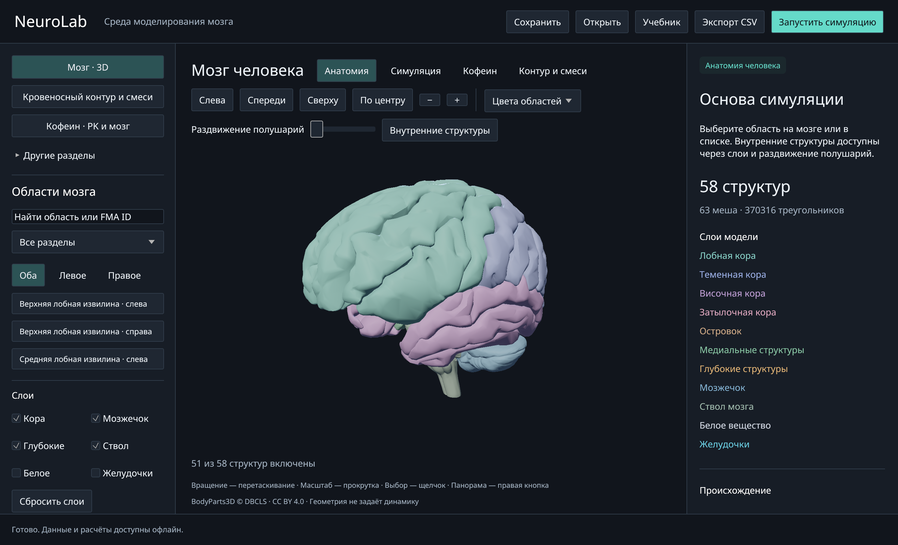
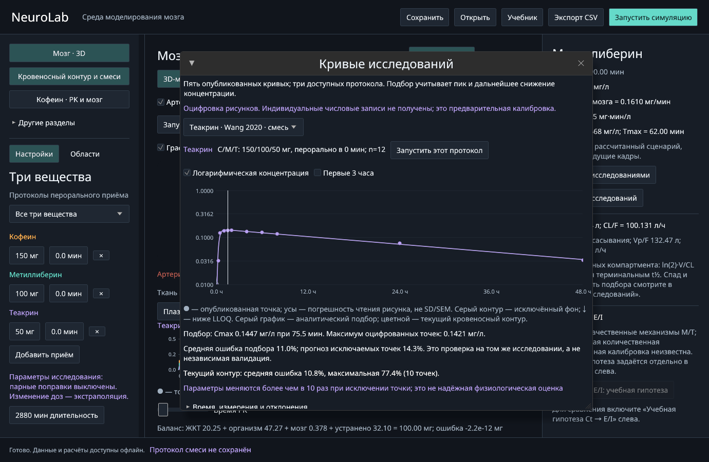

# NeuroLab

**Интерактивная среда моделирования мозга, нейронных популяций и фармакокинетики на Rust.** Нативное приложение с 3D-анатомией человека, воспроизводимым вычислительным ядром и CLI. Работает локально, без сервера и API-ключей.

[English](README.en.md) · [Документация](docs/README.md) · [Руководство пользователя](docs/user-guide.md) · [Разработка](docs/development.md) · [Научные ограничения](docs/scientific-status.md)



Анатомия: BodyParts3D, © The Database Center for Life Science, CC BY 4.0. Изображение — скриншот работающего приложения; геометрия не задаёт физиологическую достоверность модели.

## Что реализовано

| Модуль | Возможности |
|---|---|
| Анатомия | 58 структур / 63 меша BodyParts3D, внутренние структуры, FMA ID, поиск, слои, выбор поверхности, камера и сохранение сцены |
| Нейронная сеть | 47 областей серого вещества, 94 E/I-популяции Wilson–Cowan, 46 демонстрационных направленных связей с задержками, стимуляция и просмотр истории |
| Кровеносный контур | Артерии, схематические капилляры и вены; региональный кровоток; обмен с тканью; венозный возврат и баланс массы |
| Вещества | Кофеин, метиллиберин, теакрин, пары и тройная смесь; пероральные дозы, время введения, повторные приёмы, графики и CSV |
| Калибровка PK | Пять оцифрованных опубликованных кривых, три исследовательских протокола, подбор пика и спада, ошибки и проверка исключаемых точек |
| Кофеин и PET | Отдельные эмпирические оценки A1/A2A; прежняя модель кофеина сохранена для воспроизводимости |
| Учебные эксперименты | Конкурентное связывание A/B, ответ Black–Leff, карта механизмов, поиск научных терминов и подсказки |
| Воспроизводимость | Версионированный JSON, общее ядро GUI/CLI, экспорт общей и региональной трассы, аналитические и численные проверки |

Это исследовательская и учебная платформа, **не полная физиологическая симуляция мозга**. Связность сети, региональные параметры и переход концентрации в E/I частично демонстрационные. Подбор по плазменным кривым не валидирует нейронное действие, поведение, персональные дозировки или безопасность сочетаний. [Статус каждого модуля](docs/scientific-status.md).

## Быстрый запуск

Проверенная платформа — **macOS Apple Silicon / Metal**. Нужны Xcode Command Line Tools и актуальный stable Rust с `rustfmt` и `clippy`. Для Linux/Windows прохождение нативных проверок не заявляется.

```sh
xcode-select --install       # если Command Line Tools ещё не установлены
rustup component add rustfmt clippy

git clone https://github.com/arsenysmorodin/brain-engine.git
cd brain-engine
cargo run -p neuro-app --locked
```

Первой сборке нужен доступ к реестру зависимостей. Геометрия, метаданные и шрифты уже в репозитории; скачивать атлас отдельно не нужно. После сборки приложение запускается без сети:

```sh
./target/debug/neuro-app
```

В рабочей копии с уже установленным изолированным Rust вместо `cargo` используется `./scripts/cargo-local`. Этот helper **не устанавливает** `.local/` в новом клоне. Различия обычной и изолированной установки, требования и диагностика: [руководство разработчика](docs/development.md).

## Первый сценарий

1. В «Мозг · 3D» вращайте мозг перетаскиванием, приближайте прокруткой и выбирайте область щелчком. Список слева позволяет найти область по имени или FMA ID.
2. Для распространения активности откройте «Симуляция» и нажмите «Запуск». Показана демонстрационная E/I-сеть, а не измеренный коннектом.
3. Для вещества нажмите **«Запустить симуляцию»**, выберите вещество, дозу в мг и время **в минутах от начала сценария**. Добавьте строки для смеси или повторного приёма.
4. В «Кровеносный контур и смеси» выбирайте вещество, регион, слой и время. Включите «График» для плазмы, ткани, кровотока, потоков и баланса.
5. В **«Кривые исследований»** выберите исследование и **«Запустить этот протокол»**. Точки публикаций и линия полного контура сравниваются при том же составе и дозах.
6. «Сохранить» записывает проект; «Экспорт CSV» — рассчитанные данные. Наведение объясняет термины, «Учебник» открывает поиск.

[Полное руководство](docs/user-guide.md) объясняет шкалы, E/I, PET, сохранение, исследовательские протоколы и отличие двух моделей кровоснабжения.

## Калибровка: текущие границы

Используются опубликованные графики Mondal 2022 и Wang 2020. Исходные индивидуальные числовые записи не получены. Доступны **M100, C150 и C150+M100+T50 мг**; одиночный теакрин пока не откалиброван по полному временному ряду.

Средние ошибки полного контура относительно точек подбора: M100 — 4,46%; C150 — 2,69%; смесь M/C/T — 14,26% / 4,49% / 10,79%. Эти числа не являются независимой валидацией: для M смеси ошибка прогноза исключаемых точек — 32,18%, а максимальные ошибки отдельных точек смеси доходят до 77,42%. Параметры некоторых подгонок неустойчивы.



[Источники, оцифровка, уравнения, ошибки и пробелы данных](docs/full-pk-calibration.md). Даты проверки источников сохранены отдельно от даты обновления документации.

## CLI

Запуск без интерфейса:

```sh
cargo build -p neuro-cli --locked
mkdir -p output/demo
./target/debug/neuro-cli --help
./target/debug/neuro-cli atlas --csv output/demo/regions.csv > output/demo/atlas.json
./target/debug/neuro-cli simulate scenarios/brain-network.json --csv output/demo/network.csv > output/demo/network.json
./target/debug/neuro-cli new-circulation output/demo/purines.json
./target/debug/neuro-cli circulation output/demo/purines.json --csv output/demo/pk.csv > output/demo/trace.json
```

Новый `new-circulation` создаёт ревизию 4; `scenarios/purine-circulation.json` намеренно сохраняет историческую ревизию 1. Команды `new*` не перезаписывают существующий файл. JSON полной трассы может быть большим, поэтому в примерах stdout направлен в файл.

[Все команды, флаги, форматы вывода и примеры калибровки](docs/cli.md).

## Структура проекта

```text
crates/neuro-domain/   Типы, проверка документов, атласы, происхождение данных
crates/neuro-engine/   Численные модели CPU/f64, подбор, трассы, CSV
crates/neuro-app/      Bevy / egui: 3D, управление, формы, учебник
crates/neuro-cli/      Команды для того же вычислительного ядра
assets/               Геометрия и шрифты с отдельными лицензиями
data/                 Метаданные, источники, словарь и PK-референсы
scenarios/, scenes/   Воспроизводимые примеры протоколов и сцены
docs/                 Руководства, научные модели и история проверок
scripts/              Helper локального Rust и сборка macOS .app
```

[Архитектура и точки расширения](docs/architecture.md) · [Форматы JSON/CSV и версии](docs/data-formats.md) · [Индекс данных и лицензии](docs/data-and-licenses.md)

## Проверка и сборка приложения

```sh
cargo fmt --all --check
cargo test --workspace --locked
cargo clippy --workspace --all-targets --locked -- -D warnings
cargo build --workspace --locked
cargo doc --workspace --no-deps --locked
```

Обычный `cargo build` использует `default-members` без GUI; `--workspace` включает приложение. Бюджет сборки в `.cargo/config.toml` — два jobs. `--offline` добавляйте после получения зависимостей.

На macOS helper собирает локальный **debug-пакет** с атрибуциями:

```sh
./scripts/macos-app
open output/NeuroLab.app
codesign --verify --deep --strict output/NeuroLab.app
```

Это ad hoc подпись, не нотарифицированный дистрибутив. Нативная визуальная проверка проводится отдельно от компиляции. [Процедуры smoke-проверок и публикации](docs/development.md), [история результатов](docs/verification.md).

## Участие и лицензии

Изменения приветствуются через issues и pull requests. [CONTRIBUTING.md](CONTRIBUTING.md) описывает требования к коду, научным данным, коммитам и проверкам. [Дорожная карта](docs/roadmap.md) отделяет реализованное от будущей работы.

Собственный код и документация — [MIT](LICENSE). **MIT не заменяет лицензии ресурсов:** BodyParts3D и адаптированные анатомические данные — CC BY 4.0; Noto — SIL OFL 1.1. Атрибуции и условия: [THIRD_PARTY_NOTICES.md](THIRD_PARTY_NOTICES.md), [индекс данных](docs/data-and-licenses.md). Скриншоты с анатомией сохраняют атрибуцию BodyParts3D.
