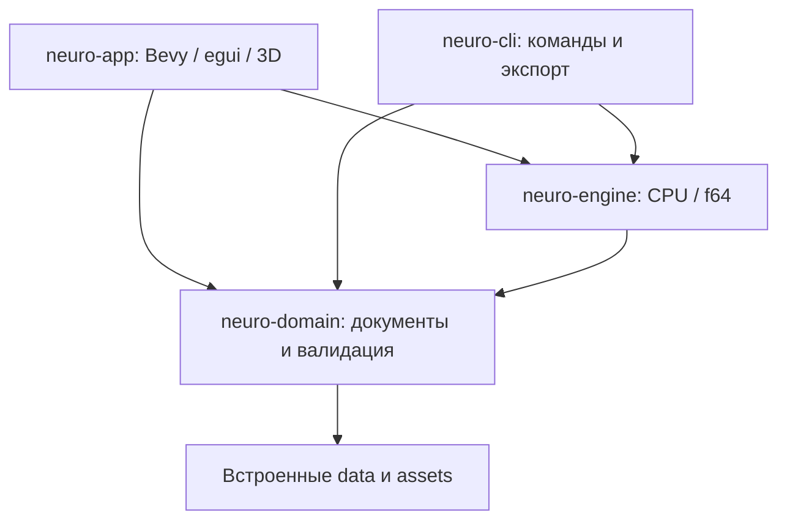

# Архитектура и расширение

[Индекс](README.md) · [Разработка](development.md) · [Форматы](data-formats.md)

## Границы crates



| Crate | Ответственность | Не должен делать |
|---|---|---|
| `neuro-domain` | Типы/единицы/версии; строгий импорт; JSON; атласы/геометрия; происхождение; атомарная запись | Зависеть от GUI или вычислительного engine |
| `neuro-engine` | Уравнения, численные решатели, подбор, трассы, метрики, CSV | Зависеть от Bevy, egui, окна, GPU или глобальных часов |
| `neuro-app` | Состояние UI, камера, рендеринг, формы/инспекторы, файловые операции и учебник | Реализовывать альтернативную научную формулу |
| `neuro-cli` | Разбор аргументов, загрузка/проверка, вызов engine, запись отчётов | Менять формулы относительно GUI |

`default-members` исключает приложение: ядро и CLI можно собирать отдельно. Bevy/bevy_egui используются только в `neuro-app`. Случайные числа/сетевые сервисы не нужны для обычного расчёта. Научные величины — `f64`; `f32` применяется к геометрии и координатам рисования.

## Путь данных

1. JSON загружается в доменный тип и проверяется по версии, структуре, конечности чисел, диапазонам и ссылкам на атлас.
2. GUI/CLI вызывают один и тот же расчёт соответствующего модуля engine.
3. Возвращается вычисленный результат или трасса со сценарием и версиями. CSV строится из этого результата.
4. GUI выбирает кадр/слой и переводит значения в визуальную шкалу; цвет не является дополнительной научной моделью.
5. При изменении зависимых параметров GUI инвалидирует старую трассу/сравнение. Новый протокол запускается после успешной проверки и расчёта.

Единой функции `evaluate` для всех моделей нет: абстрактные эксперименты используют `evaluate_experiment`, динамические модули — свои общие `simulate_*`/`compare_*`. Общим является путь расчёта для GUI и CLI, а не имя одной функции.

## Карта вычислительных модулей

Все пути ниже относительно корня репозитория; публичные типы и функции переэкспортируются из `neuro-domain`/`neuro-engine`.

| Модуль engine | Вход / основной вызов | Выход / спецификация |
|---|---|---|
| `src/lib.rs` | `Scenario`, `calculate`, `evaluate`, `evaluate_experiment` | `Occupancy`, `Evaluation`; [A/B](model.md) |
| `response.rs` | `ResponseScenario`, `calculate_response`, `evaluate_response` | `ResponseEvaluation`; [Black–Leff](response-model.md) |
| `network.rs` | `NetworkScenario`, `NetworkSimulation`, `simulate_network` | `NetworkTrace`; [сеть](network-model.md) |
| `caffeine.rs` | `CaffeineScenario`, `simulate_caffeine`, `caffeine_pet_estimates` | `CaffeineTrace`; [кофеин](caffeine-model.md) |
| `perfusion.rs` | `simulate_perfusion`, `caffeine_arterial_boundary` | `PerfusionTrace`; [односторонняя доставка](perfusion-model.md) |
| `circulation.rs` | `CirculationScenario`, `simulate_circulation` | `CirculationTrace`; [полный контур](circulation-model.md) |
| `pk_reference.rs` | `compare_purine_pk` | Сверка подходящих сводных показателей; [ревизия 3](pk-reference-review.md) |
| `pk_fit.rs` | `PkCurveDataset`, `fit_pk_curves`, `fitted_pk_protocols` | `PkCurveFitReport`, исследовательские сценарии; [подбор](full-pk-calibration.md) |
| `purine_neural.rs` | `compare_purine_network`, `purine_illustrative_drive` | Снимок Ct и две сетевые трассы; [учебная гипотеза](circulation-model.md) |

Пути таблицы расположены в `crates/neuro-engine/`. API-справка генерируется `cargo doc --workspace --no-deps --locked`; это дополнение к научным спецификациям, а не замена описания единиц и ограничений.

Минимальный вызов из Rust-проекта с зависимостями `neuro-domain` и `neuro-engine`:

```rust
use neuro_domain::{BrainAtlas, CirculationScenario, Parameters};
use neuro_engine::{calculate, simulate_circulation};

fn main() -> Result<(), neuro_domain::Error> {
    let binding = calculate(Parameters { a: 3.0, b: 6.0 })?;
    println!("Доля A: {}", binding.p_a);

    let atlas = BrainAtlas::bundled()?;
    let mut scenario = CirculationScenario::reference(&atlas, 1); // mask: C=1, M=2, T=4
    scenario.duration_min = 5.0;
    let trace = simulate_circulation(scenario, &atlas)?;
    println!("Cp на 5 мин: {} мг/л", trace.at(5.0).systemic[0].central_mg_l);
    Ok(())
}
```

Для полного воспроизведения загрузите сериализованный сценарий через `CirculationScenario::load`, а не создавайте новый референс: референс может измениться в будущей ревизии.

## Организация приложения

- `brain/mod.rs`, `controls.rs`, `render.rs`: состояние анатомической сцены, камера, слои, выбор и визуализация мешей.
- `brain/simulation.rs`: редактирование и пошаговое выполнение сети.
- `brain/vascular.rs`: анатомические артерии; `brain/circulation/geometry.rs` — собственная схематическая капиллярная/венозная геометрия.
- `brain/caffeine.rs`, `brain/circulation.rs`: PK-состояние, время, региональный инспектор, invalidation и вызовы ядра.
- `brain/circulation/study_curves.rs`: просмотр пяти кривых, запуск целого исследовательского протокола, точки и ошибки фактического контура.
- `launcher.rs`: отдельный черновик доз/времени; отмена или невалидный ввод не заменяют текущий результат.
- `files.rs`: выбор типа сохранения/экспорта и защита входов.
- `glossary.rs`: поиск и общие hover-подсказки по тексту/обозначениям.
- `smoke.rs`: детерминированные сценарии нативной проверки, скриншоты и маркеры завершения.

## Три независимые структуры

**Анатомия.** `BrainAtlas`/`BrainGeometry`, FMA ID и меши. Парные меши и группа интерфейса не задают функциональные проекции.

**Функциональная сеть.** `NetworkScenario` связывает области по ID, задаёт E/I-параметры, веса, задержки и стимулы. Белое вещество и желудочки автоматически популяциями не становятся.

**Транспорт.** Параметры кровотока, объёмов и обмена связываются с областями отдельно. Анатомическая артериальная геометрия не является решателем давления/коллатералей.

## Время и сопряжение

Сеть использует модельные миллисекунды, PK — минуты/часы. Шаг численного интегрирования, частота сохранения кадров и скорость проигрывания — разные параметры.

E/I-гипотезы фиксируют один PK-снимок и сравнивают два одинаковых сетевых опыта. Нет автоматического пересчёта минут в миллисекунды физиологии, нейронной обратной связи в кровоток, механизма бодрости или обучения виртуального человека.

## Версии и совместимость

Идентичность задают `model_id`, `model_revision`, `format_version`, атлас и provenance. Новая формула требует новой ревизии и тестов. Старые циркуляционные ревизии сохраняют свои правила/параметры; добавление отсутствующего поля через serde default не должно незаметно менять старую динамику. [Таблица версий](data-formats.md).

`calibration_curve_ids` связывает исследовательский протокол с источниками. Состав и дозы сопоставляются до показа точек; при изменении параметров качество оценивается по фактической трассе. Кофеиновые He-ориентиры не подставляются в отдельный подобранный протокол Mondal.

## Как добавить расширение

1. Определите задачу, наблюдаемые величины, единицы, вид и научные границы; выберите первоисточник и статус проверки.
2. Добавьте доменные типы/версию/валидацию, затем независимый от GUI расчёт в engine.
3. Для формулы добавьте аналитический предел, численное сравнение/сходимость, причинность и баланс, где применимо.
4. Подключите один расчёт к CLI и GUI; обеспечьте сохранение сценария и экспорт необходимых исходных параметров.
5. Добавьте воспроизводимый пример и документацию; проверьте старые документы и invalidation.
6. Отдельно проверьте визуализацию и пользовательский путь. Хороший график сам по себе не подтверждает биологическую модель.

Изменение атласа/геометрии требует обновить манифест, соответствие FMA, права/хеши, импортёр и численные сценарии, ссылающиеся на области. Копирование чужой геометрии без атрибуции не заменяет процедуру импорта.
